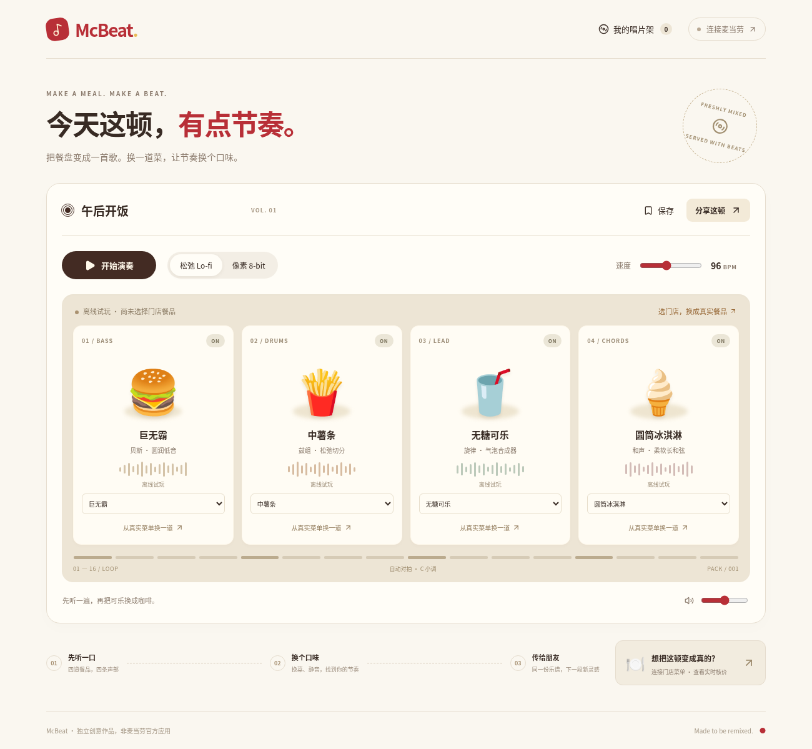
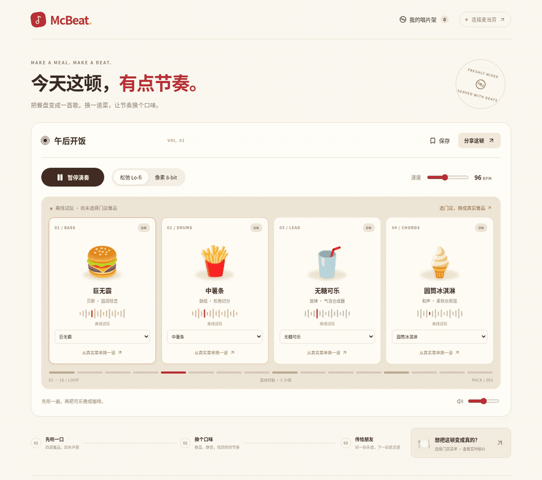
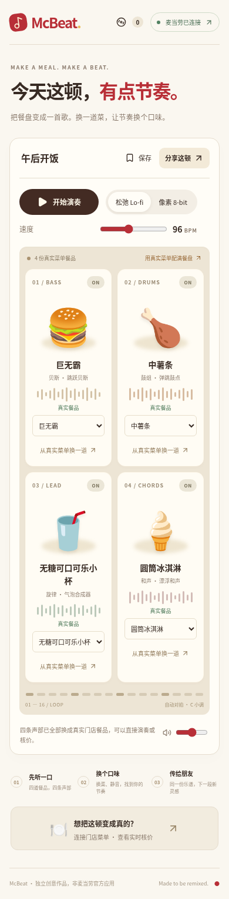
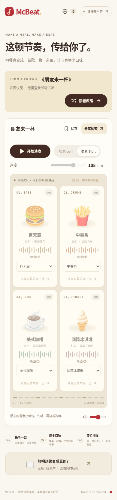

# McBeat

**今天这顿，有点节奏。**

把一顿麦当劳变成四声部音乐：换一道餐品，就换一段节奏；发一个链接，朋友便能接着改编。适合想玩一点音乐、和朋友交换创意的麦当劳用户，无需音乐基础。

[在线体验 ↗](https://mcbeat-meal-mixes.woodsy-lime-5011.chatgpt.site) · [有声演示](#有声演示) · [快速开始](#快速开始) · [MCP 接入](MCP_INTEGRATION.md) · [参赛报名](https://github.com/M-China/mcd-developer-innovation-challenge/issues/1142)

- **餐盘就是乐谱**：主食演奏贝斯、小食打鼓、饮料负责旋律、甜品铺上和声；支持 Lo-fi / 8-bit、76–124 BPM，以及逐声部静音。
- **真实餐品参与创作**：从门店菜单选择餐品，调整套餐选项，再查询当前门店的实际价格。
- **朋友接着玩**：免登录试听，点击「接着改编」生成独立版本；原曲保留，新版本可以再次分享。

## 有声演示

**31 秒 · McBeat 实际演奏原声 · 中文字幕**

[▶ 在线播放](https://mcbeat-meal-mixes.woodsy-lime-5011.chatgpt.site/demo.html) · [GitHub 视频文件](public/media/mcbeat-demo.mp4) · [下载 MP4](https://github.com/Beaconsyh08/mcbeat/raw/refs/heads/main/public/media/mcbeat-demo.mp4)

[](https://mcbeat-meal-mixes.woodsy-lime-5011.chatgpt.site/demo.html)

演示顺序：**Lo-fi 演奏 → 可乐换咖啡 → 切到 8-bit → 分享 → 朋友换成麦乐鸡 → 再分享**。视频与封面均已收录在本仓库；点击封面打开播放器并开启声音。

<details>
<summary>快速预览：12 秒无声动图</summary>



动图由实际操作页面截帧组成，每步停留 2 秒。视频和动图使用离线试玩餐盘，无需 Token 即可体验。

</details>

## 怎么玩

1. **先听一口**：打开网页，点击「开始演奏」。四份餐品组成一首循环音乐。
2. **换个口味**：换一道餐品、切换风格或静音声部；播放中的修改会在下一小节接上。
3. **传给朋友**：点击「分享这顿」发送链接。朋友可以直接试听，再点「接着改编」做出自己的版本。

草稿和「我的唱片架」保存在当前浏览器；跨设备使用时请保留分享链接。

## 快速开始

直接使用[在线版](https://mcbeat-meal-mixes.woodsy-lime-5011.chatgpt.site)即可试玩。开发者本地运行需要 **Node.js 22.13+**：

```sh
git clone https://github.com/Beaconsyh08/mcbeat.git
cd mcbeat
npm ci

# 首次运行生成本机会话加密密钥，已有配置不会被覆盖。
node -e 'const fs=require("node:fs"),c=require("node:crypto"); if(!fs.existsSync(".dev.vars"))fs.writeFileSync(".dev.vars","MCBEAT_SESSION_KEY="+c.randomBytes(32).toString("hex")+"\n",{mode:0o600})'

npm run dev -- --host 127.0.0.1 --port 4173
```

打开 http://127.0.0.1:4173/ 。构建使用 `npm run build`，随后可用 `npm start` 运行构建后的 Worker。

## 用真实餐品创作

1. 在[麦当劳 MCP 平台](https://open.mcd.cn/mcp)登录并激活服务，获取自己的 Token。
2. 在 McBeat 点击「连接麦当劳」，输入 Token，搜索并选择门店。
3. 点击「用真实菜单配满餐盘」，或逐项选择餐品、调整套餐选项。
4. 查询当前餐盘价格，或直接演奏并分享给朋友。

**连接成功不会自动替换离线餐盘。** 只有从门店菜单和详情接口成功取得的餐品才标记为「真实餐品」；缺货或查询失败会保留原内容并提示。朋友重新核价时需使用自己的连接和所选门店。

| 门店真实餐盘 | 朋友收到的乐谱 |
| :---: | :---: |
|  |  |
| 一键匹配四声部，也能逐项换菜 | 先听原曲，再改成自己的节奏 |

左图来自 2026-10-23 的线上真实 MCP 联调；右图为离线试玩乐谱。餐品供应和价格以门店实时返回为准。

## MCP 如何参与

| 官方工具 | 在 McBeat 中的作用 |
| --- | --- |
| `query-nearby-stores` | 按城市、地标查找并选择门店 |
| `query-meals` | 获取该店真实菜单，匹配四条声部 |
| `query-meal-detail` | 读取单品与套餐详情，校验替换选项 |
| `calculate-price` | 按当前门店与餐盘重新核价 |

浏览器通过本站服务端连接固定的官方地址 `https://mcp.mcd.cn`。Token 由 AES-GCM 加密后保存在 1 小时 HttpOnly 会话 Cookie 中，不进入源码、localStorage 或分享链接。当前 MVP 仅调用上述查询工具，不下单、支付或领券。

协议、调用参数和真实联调记录见 [MCP_INTEGRATION.md](MCP_INTEGRATION.md)。独立 MCP 客户端可参考 [mcp-config.example.json](mcp-config.example.json)，其中 `${MCD_MCP_TOKEN}` 是占位符，需由客户端注入或在私密配置中替换。

## 开发与 Skill

React + Vinext / Cloudflare Workers 提供页面与服务端；Web Audio 合成四声部音乐。版本化乐谱放在 URL fragment 中，包含餐品与编曲参数，不含凭据或门店位置。固定声音包与确定性噪声让相同乐谱可复现。

智能体入口：[skills/mcbeat/SKILL.md](skills/mcbeat/SKILL.md)。例如：

> McBeat，把巨无霸、薯条、咖啡和苹果派做成 96 BPM 的 Lo-fi，给我一个朋友能接着改编的链接。

配套脚本 `scripts/create-mix.mjs` 从 stdin 接收四份餐品的 JSON，输出分享链接；输入格式和用法见 Skill。

```sh
npm test           # 业务契约
npm run typecheck  # TypeScript
npm run build     # 生产构建
```

已验证真实 MCP 查询与核价、分享和独立改编、保存恢复、1300 / 390 / 320px 布局，以及有声视频的音轨与播放。各项证据和限制见 [VALIDATION.md](VALIDATION.md)。

## 参赛与许可

- [官方参赛声明](CONTEST_DECLARATION.md) · [报名 Issue #1142](https://github.com/M-China/mcd-developer-innovation-challenge/issues/1142)，报名状态以官方回复为准。
- 原创代码采用 [MIT License](LICENSE)；第三方依赖和官方内容的权利说明见 [THIRD_PARTY_NOTICES.md](THIRD_PARTY_NOTICES.md)。

McBeat 是独立创意作品，非麦当劳官方应用。
